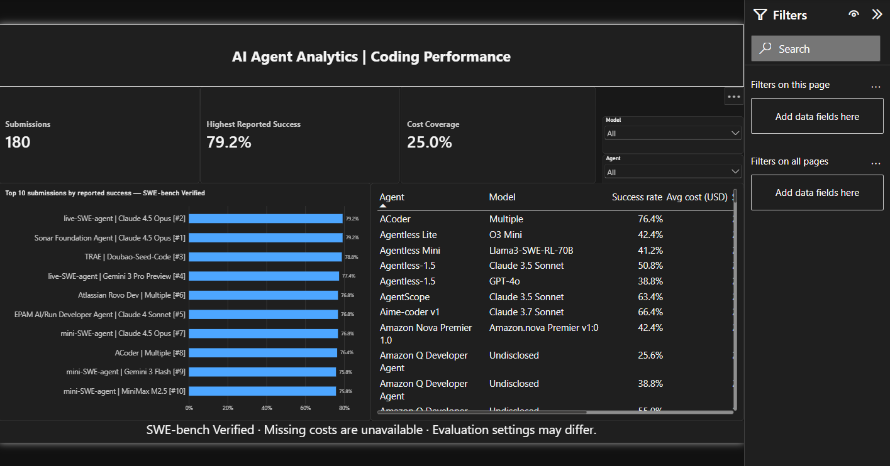
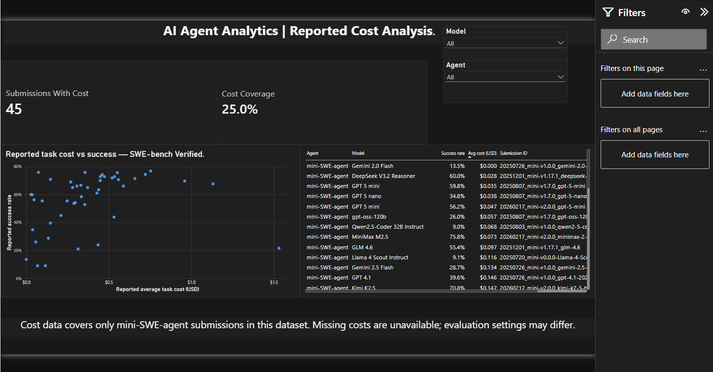
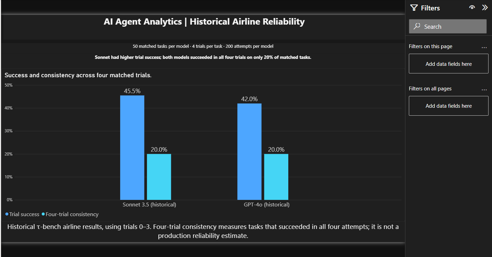

# AI Agent Performance, Cost & Reliability Analytics — 2026

## Project purpose

Help a company shortlist AI agents for further testing by comparing
reported coding performance, available task costs, and historical
consistency across repeated airline-support tasks.

## Dashboard pages

### Coding Performance



### Cost Analysis



### Historical Reliability



## Key findings

- The SWE-bench Verified dataset contains 180 submissions.
- The highest reported success rate is 79.2%.
- Only 45 submissions (25%) include reported task costs.
- All submissions with reported costs in this dataset use mini-SWE-agent,
  limiting cost comparisons across agents.
- On 50 matched historical airline tasks, Sonnet achieved 45.5% trial
  success and GPT-4o achieved 42.0%.
- Both models succeeded in all four trials on 20% of matched tasks.

## Business takeaway

Use these results to build a shortlist for company-specific pilots.
Assess performance, cost, and consistency together before selecting
an agent for deployment.

## Limitations

- Missing costs mean unavailable data, not zero cost.
- Benchmark submissions may use different evaluation settings.
- Coding and airline-support benchmarks measure different tasks;
  their scores should not be combined into one ranking.
- Historical airline results do not estimate production reliability.
- The project title includes 2026, but the underlying results include
  historical submissions and are not a live market ranking.

Project folder: `C:\Users\rumai\Downloads\AI agents performace analysis\ai-agent-analytics`

## Start here

Python 3.10+ and its standard library are sufficient. No paid APIs, model execution,
scraping framework, account, or third-party Python packages are required.

```powershell
git clone https://github.com/Althafk7171/ai-agent-performance-analytics.git
cd ai-agent-performance-analytics
python pipeline.py
python -m unittest discover -s tests -v
```

To collect the configured pinned revisions again:

```powershell
python pipeline.py --refresh
```

To replay a particular snapshot to a separate destination:

```powershell
python pipeline.py --manifest data/raw/20261006T070839402852Z/manifest.json --output data/processed/replays/check
```

`--refresh` creates a new raw snapshot and updates processed exports only after all
sources have downloaded and normalized successfully. It does **not** move to upstream
HEAD; intentionally update `config/sources.json` revisions when collecting a new version.
Failed downloads leave an incomplete raw directory without a manifest; it is never selected
for default replay. CSV files are deterministic for a given snapshot; refresh timestamps
and manifests differ on a new collection. Raw bytes are never rewritten by normalization.

## Source selection

| Public source                                                                          | Included scope                                                             | Analytics value                                                               |
| -------------------------------------------------------------------------------------- | -------------------------------------------------------------------------- | ----------------------------------------------------------------------------- |
| [SWE-bench official leaderboard data](https://github.com/SWE-bench/swe-bench.github.io) | Verified and Multilingual summaries and all available per-instance details | Published resolution rates; reported task costs and API calls where available |
| [Sierra τ-bench historical trajectories](https://github.com/sierra-research/tau-bench) | Airline traces for gpt-4o and sonnet-35-new                                | Binary outcomes across repeated trials; tool calls; requested human handoffs  |

Structured public JSON is more reliable here than HTML scraping. Two benchmark families
are enough for the initial portfolio. Sources differ in tasks and evaluation settings:
there is no global score or combined agent ranking. See [provenance](docs/provenance.md)
for revisions, licenses, known limitations and field origins.

```text
config/sources.json          Source selection and pinned revisions
pipeline.py                 Download, normalize, validate and export
data/raw/<snapshot>/        Original JSON, license copies and manifest
data/processed/             CSVs, analytics.sqlite and quality_report.json
docs/data_dictionary.md      Column meanings and table grains
docs/provenance.md           Observed vs derived values and limitations
docs/next_steps.md           SQL, Excel and Power BI plan
sql/starter_analysis.sql     Three initial analytical queries
tests/test_pipeline.py       Data integrity and metric semantics checks
```

The included snapshot contains **195 summaries, 24,497 task records and 100 task reliability
records**. Of the task records, 23,897 have reported agent cost. No records have latency
data; no records are simulated. These are available source records, not complete
operational telemetry for every listed submission.

## Use in Excel, SQL and Power BI

Load CSVs using **Data → From Text/CSV** in Excel or **Get data → Text/CSV** in Power BI.
Use text types for IDs, decimal types for costs, whole numbers for counts and flags,
and percentage formatting for fractions. Empty cells represent missing data.
For SQLite, open `data/processed/analytics.sqlite` and run `sql/starter_analysis.sql`.

Keep summary and task-level visuals separate. Never sum percentages, replace missing
costs with zero, or blend benchmark variants. Filter by submission/agent settings before
comparing models. No complexity, latency, token use, department or user-rating values
have been invented to fill missing information.
